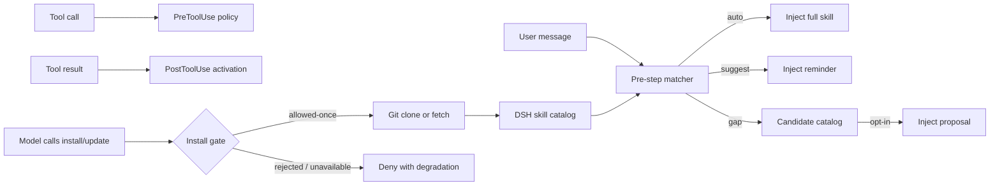

<div align="center">

<a id="dsh-skills-manager"></a>

# 🧩 dsh-skills-manager

**Proactive skill activation, hook orchestration, and GitHub sync for DeepSeek Harness.**

<strong>English</strong> · <a href="./README.zh-CN.md">简体中文</a>

[](https://www.npmjs.com/package/@existence001100/dsh-skills-manager)
[](https://github.com/Existence001100/dsh-skills-manager/actions/workflows/ci.yml)
[](./LICENSE)
[](https://nodejs.org/)
[](https://github.com/Existence001100/dsh-skills-manager/commits/main)
[](https://github.com/Existence001100/dsh-skills-manager/stargazers)

</div>

**🚀 Quick install**

```sh
dsh plugin --profile web add @existence001100/dsh-skills-manager
```

Restart the Web profile after installation. See [requirements and installation options](#quick-start).

> **Changed in 1.1.0:** a model-initiated `skill_manager install` or `skill_manager update` now needs one approval decision. To restore the 1.0.x behavior, run `skill_manager set-config config={"installGate":"off"}`. See [install consent gate](#install-consent-gate).

[🚀 Installation](#quick-start) · [✨ Features](#highlights) · [⚙️ Configuration](#skill-configuration) · [🐛 Feedback](https://github.com/Existence001100/dsh-skills-manager/issues)

## Table of contents

- [Why this plugin](#why-this-plugin)
- [Highlights](#highlights)
- [How it works](#how-it-works)
- [Quick start](#quick-start)
- [Compatibility](#compatibility)
- [Skill configuration](#skill-configuration)
- [Hook compatibility](#hook-compatibility)
- [GitHub-managed skills](#github-managed-skills)
- [Install consent gate](#install-consent-gate)
- [Candidate catalog](#candidate-catalog)
- [Project-scoped skills](#project-scoped-skills)
- [Management and observability](#management-and-observability)
- [Permissions and data](#permissions-and-data)
- [Security](#security)
- [Decisions we deliberately do not make](#decisions-we-deliberately-do-not-make)
- [Development](#development)

## Why this plugin

The built-in DSH `skill` tool relies on the model to notice a short summary and decide to load the full skill. In practice, useful skills are often missed, skill files cannot directly declare lifecycle behavior, and locally scattered skills are difficult to keep synchronized.

`dsh-skills-manager` closes those gaps:

- matches every user turn against available skills;
- loads strong matches automatically and suggests weaker matches;
- maps Claude Code-style hook declarations onto DSH host events;
- manages skill sources from GitHub;
- keeps user and project overrides isolated;
- exposes controls in Settings and through the `skill_manager` model tool.

## Highlights

| Icon | Capability | Description |
| --- | --- | --- |
| 🚀 | Proactive activation | Full skill injection for strong matches and lightweight reminders for suggestions |
| 🪝 | Skill-level hooks | `UserPromptSubmit`, `PreToolUse`, `PostToolUse`, `PostToolUseFailure`, and `SessionStart` |
| 🔄 | GitHub lifecycle | Install, update, authoritative sync, uninstall, and commit-change reporting |
| 🧭 | Workspace-aware scope | Project skills override user skills without leaking configuration between workspaces |
| 🛠️ | Built-in management | Settings UI plus the `skill_manager` model tool |
| 🛂 | Install consent gate | A model-initiated `install` or `update` asks once. It fails closed without an approval channel. |
| 🧩 | Capability proposal | An opt-in catalog proposes missing skills. One card per turn. It never auto-installs. |
| 🛡️ | Guardrails | Source allowlisting, argument-array Git execution, hook path validation, and no shell execution for hooks |

## How it works



Before each agent step, the plugin scores available skills:

1. explicit skill-name mention: **+12**;
2. trigger phrase or regular expression: **+7**;
3. description or `whenToUse` token overlap: **+4 to +6**.

By default, a turn can auto-load up to two skills and suggest up to three. Activation markers are stored in conversation history, so full skill content is not injected repeatedly while it remains visible. After context compaction removes a marker, the skill can be loaded again automatically.

Two separate constraints keep the model from acting on its own:

- **Install consent gate.** Before a model-initiated `skill_manager install` or `skill_manager update` runs any Git command, the plugin asks the host approval seam for one decision. Only `allowed-once` proceeds. Rejection, cancellation, a missing channel, or a thrown request all deny. The model receives a degradation note and a structured code (see [Install consent gate](#install-consent-gate)).
- **Capability proposal.** When an opt-in candidate catalog names sources that are not installed, the matcher may inject a proposal into the turn's first step. The proposal is model context, not a UI card, and it never installs anything on its own — the model must still call `install`, which the gate above will intercept. The branch is off by default and stays silent when the catalog is missing, the score is low, or every declared skill is already installed (see [Candidate catalog](#candidate-catalog)).

## Quick start

### Requirements

- DeepSeek Harness `0.1.1-rc.2`, `0.1.2-alpha.3`, `0.1.3-alpha.1`, or `0.2.0-rc.2`;
- Node.js `^22.19.0 || >=24.0.0`;
- pnpm available on `PATH` for `dsh plugin`.

### Install from npm (recommended)

```sh
dsh plugin --profile web add @existence001100/dsh-skills-manager
```

DSH recognizes the package's `dsh.bundle` manifest and adds `@existence001100/dsh-skills-manager` to the Web profile automatically. Restart a running Web profile after installation.

### Install from GitHub

```sh
dsh plugin --profile web add github:Existence001100/dsh-skills-manager
```

Use the GitHub source when testing unreleased changes from `main`. Pin a commit when reproducibility matters.

### Update or remove

```sh
dsh plugin --profile web update @existence001100/dsh-skills-manager
dsh plugin --profile web remove @existence001100/dsh-skills-manager
```

Restart the profile after either operation so its composition matches the installed bundle set.

### Install a local checkout for development

```sh
git clone https://github.com/Existence001100/dsh-skills-manager.git
cd dsh-skills-manager
pnpm install --frozen-lockfile
dsh plugin --profile web add .
```

The included `cordis.patch.yml` inserts `skill-manager` into the host composition for all sessions.

## Compatibility

| Component | Supported or continuously verified |
| --- | --- |
| DeepSeek Harness | `0.1.1-rc.2` dependency contract; `0.1.2-alpha.3` dependency contract plus isolated install and UI smoke tests; `0.1.3-alpha.1` tagged-source API review and session-hook regression tests; `0.2.0-rc.2` isolated install, Web boot, Settings API, and live `/name` skill invocation |
| Node.js | `22.19.0` and `24.19.0` |
| pnpm | `11.19.0` with a frozen lockfile |
| Operating systems | Ubuntu and Windows CI matrix |

The `0.1.3-alpha.1` adaptation supports `session.snapshotEvents()` and array-based surface nodes while retaining the legacy events API. Full install/UI smoke testing for that release is pending availability of its host packages on npm.

For DSH `0.2.0-rc.2`, use plugin `1.0.6` or later: older plugin versions emit `source.kind: "plugin"`, which DSH's v4 session format rejects. A live Web-profile test invoked `/ponytail-help`, loaded its full instructions (`skill-invocation`), recorded the manager notice as `plugin:dsh-skills-manager`, and completed the turn. This verifies explicit skill invocation and manager injection; other `0.2.x` host versions are outside the current peer range.

DSH is in developer preview. Pin the plugin to a commit when reproducibility matters, and re-run the install smoke test when upgrading DSH dependencies.

## Skill configuration

Declare activation and hooks directly in SKILL.md frontmatter:

```yaml
---
name: repo-hardening
description: Review and harden a repository with build/test gates.
metadata:
  activation: auto             # auto | suggest | off
  triggers:
    - "harden"
    - "build fails"
    - "re:exit code \\d+"
  hooks:
    UserPromptSubmit:
      inject: "Run build and tests before reaching a conclusion."
    PreToolUse:
      - tool: bash
        when: "git push"       # substring or re:<pattern>
        decision: deny         # allow | deny | ask
        reason: "Direct pushes are not allowed"
    PostToolUse:
      - tool: bash
        when: "re:exit code [1-9]"
        action: activate
    SessionStart:
      activate: true
---
```

### Activation modes

| Mode | Behavior |
| --- | --- |
| `auto` | A match injects the complete skill immediately |
| `suggest` | A match adds a lightweight reminder so the model can load the skill |
| `off` | The skill never participates automatically but remains manually invocable |

Codex-style `manual` and `disabled` values are accepted as aliases for `off`. If `activation` is omitted, skills with explicit triggers default to `auto`; all others default to `suggest`.

DSH also accepts `/name` for a user-invocable skill. This loads the full instructions directly, regardless of whether the manager would suggest it; `suggest` alone only adds a reminder.

### Triggers and policies

- Plain trigger strings use case-insensitive substring matching.
- Values prefixed with `re:` are treated as regular expressions; invalid expressions are ignored.
- `PreToolUse.tool` accepts a concrete tool name or `*`.
- Tool policies return `allow`, `deny`, or `ask` with an optional reason.
- User overrides can be stored outside upstream SKILL.md files so updates do not erase local policy.

Example overrides:

```text
skill_manager set-triggers ponytail-review triggers=["review this diff","over-engineering"]
skill_manager set-hooks repo-hardening hooks={"PostToolUse":[{"tool":"bash","when":"re:exit code [1-9]","action":"activate"}]}
```

## Hook compatibility

| Skill hook | DSH host event | Support |
| --- | --- | --- |
| `UserPromptSubmit` | `agent/pre-step` | ✅ Inject text on every submission while active |
| `PreToolUse` | `tools/pre-execute` | ✅ Allow, deny, or ask based on tool and arguments |
| `PostToolUse` | `tools/post-execute` | ✅ Activate a skill from matching tool output |
| `PostToolUseFailure` | `tools/post-execute` | ✅ Match failure text through the same result event |
| `SessionStart` | `agent/session-start` | ✅ Activate before matching is required |
| `SessionEnd` / `Stop` | `agent/disposed` / `agent/turn-stopping` | ⚠️ Observable only; no content injection |
| `PreCompact` | No DSH core equivalent | ⚠️ Not implemented; removed activation markers allow reinjection |

## GitHub-managed skills

The manager accepts `owner/repo` shorthand and full `https://`, `git@`, or `ssh://` Git URLs.

```text
skill_manager install owner/repo
skill_manager update
skill_manager status
skill_manager uninstall skill-name
```

During installation, the plugin:

1. shallow-clones one branch into `<DSH_HOME>/skill-sources/<slug>`;
2. discovers SKILL.md directories up to depth 3;
3. ignores `.git`, `node_modules`, `dist`, and `build`;
4. copies discovered skills into `<DSH_HOME>/skills/<name>`.

Updates fetch the configured ref, reset the source to `FETCH_HEAD`, and perform an authoritative resync of installed skills. Filesystem watchers then invalidate the catalog automatically and emit `skills/change`.

Plugin manifests are detected in this order:

1. `.codex-plugin/plugin.json`;
2. `.claude-plugin/plugin.json`.

The Settings page displays the plugin name, version, skills, and hook count. Safe in-repository Node lifecycle hooks are supported for `SessionStart` and `UserPromptSubmit`.

State is stored in `<DSH_HOME>/skill-manager.json`, including sources, refs, commits, installed paths, scoped overrides, and the 50 most recent operations.

## Install consent gate

The model cannot install or update a Git source on its own. Each model-initiated `skill_manager install` and `skill_manager update` call asks for one decision first.

| `installGate` | Behavior |
| --- | --- |
| `ask` (default) | Shows one approval card, then runs only after the user allows that call. |
| `deny` | Blocks the call without a card. The model learns the reason and can point the user to Settings. |
| `off` | Restores the 1.0.x behavior. Nothing asks. |

The card names the source and says the install copies the whole repository. The card also states that hooks stay unverified before installation. The plugin has not cloned the repository yet.

The gate fails closed. If no approval channel is available, if the request throws, or if the user rejects or cancels, then no Git command runs. The model receives a short degradation note and a structured code:

| `code` | Cause |
| --- | --- |
| `user-rejected` | The user rejected the card. |
| `approval-cancelled` | The user cancelled the card, or the turn aborted. |
| `approval-unavailable` | No approval answerer is mounted in this deployment. |
| `approval-error` | The approval request threw. |
| `policy-deny` | `installGate` is `deny`. |
| `invalid-source` | The URL is missing or unsupported. The text repeats the install error word for word. |
| `no-agent` | The call has no agent, so no user can be asked. |

Configure the gate through the model tool:

```text
skill_manager set-config config={"installGate":"off"}
```

The gate is plugin policy, not a skill hook. A skill cannot switch it off.

An install that the user starts in Settings → **Skill Management** does not ask. The user already decided by starting it.

## Candidate catalog

A capability gap can be proposed only when a catalog names installable sources. The catalog is opt-in and off by default.

```json
{
  "version": 1,
  "entries": [
    {
      "repo": "owner/repo",
      "description": "What this skill repository covers",
      "triggers": ["review", "re:exit code [1-9]"],
      "skills": ["review-helper"],
      "hooks": { "PreToolUse": true },
      "verified": false
    }
  ]
}
```

| Field | Meaning |
| --- | --- |
| `repo` | Required. A Git source that passes the same allowlist as `install`. |
| `description` | Required. The matching text. Capped at 300 characters. |
| `triggers` | Optional. Same syntax as `metadata.triggers`. Capped at 32 entries. |
| `skills` | Optional. Declared skill names. Unverified until installed. |
| `hooks` | Optional. Declared event names. Unverified until installed. |
| `verified` | Optional. The curator checked the repository by hand. |

- The path comes from `candidateCatalogPath`. The default is `<DSH_HOME>/skill-manager-candidates.json`.
- Caps: 200 entries, 300-character descriptions, 32 triggers per entry.
- A `repo` outside the Git allowlist is dropped. The catalog never widens what may be cloned.
- The catalog lists sources. It is not a registry: installed-skill metadata still comes only from `ctx.skills`.
- Turn it on with `skill_manager set-config config={"proposeEnabled":true}`.
- Tune it with `proposeThreshold` (default 7) and `maxPropose` (default 1, at most one card per turn).
- The branch stays silent when the file is missing, the score is low, or every declared skill is installed.
- A failed load logs one warning per file version. The same broken file does not repeat the warning.
- A proposal is model context. It may not appear in the conversation, and no UI tracks it.

## Project-scoped skills

The filesystem provider resolves skill roots in priority order:

| Priority | Root | Source |
| --- | --- | --- |
| 1 | `<project>/.dsh/skills` | `project-dsh` |
| 2 | `<project>/.agents/skills` | `project-agents` |
| 3 | Host-configured directory | `custom` |
| 4 | `<DSH_HOME>/skills` | `user-dsh` |
| 5 | `<agentsHome>/skills` | `user-agents` |
| 6 | Bundled skills | `bundled` |

Project skills participate in the same matching pipeline and win same-name conflicts by priority. Mode, trigger, and hook overrides are keyed by `scope` plus `cwd`, preventing settings from leaking across projects or into user-level skills.

Project-local skills remain owned by the project's Git repository. The manager's `update` operation synchronizes user-level sources only; filesystem watchers refresh project changes.

## Management and observability

### Settings UI


*The settings page shows activation controls, source details, and skill management actions.*

Settings → **Skill Management** provides:

- English and Simplified Chinese copy that follows the active DSH display language;
- a master switch for proactive activation;
- per-turn auto-load limits;
- GitHub install and update controls;
- per-skill mode, trigger, hook, source, and commit details;
- project workspace selection;
- uninstall actions and recent operation history.

### Model tool

The `skill_manager` tool supports `status`, `install`, `update`, `uninstall`, `set-mode`, `set-triggers`, `set-hooks`, and `set-config`. Project records use `scope: project` plus a required `cwd`.

### Events

- `skill-manager/hook` — `{ event, skill, action, detail, at }` for hook activity.
- `skill-manager/update` — synchronization results after install, update, or uninstall.
- `skills/change` — emitted by the filesystem provider after catalog changes.

## Permissions and data

| Surface | Behavior |
| --- | --- |
| Filesystem reads | Reads DSH user and project skill roots selected by the host, plus metadata from configured Git sources |
| Filesystem writes | Stores sources under `<DSH_HOME>/skill-sources`, manager-owned skills under `<DSH_HOME>/skills`, and state in `<DSH_HOME>/skill-manager.json` |
| Network | Invokes the local `git` executable only for user-requested source installation or update; the plugin implements no telemetry |
| Processes | Runs `git` with argument arrays and may run explicitly declared in-repository Node lifecycle hooks with time and output limits |
| Agent-initiated install | Asks for one approval decision before any Git command runs, and fails closed without an approval channel |
| Credentials | Does not store Git credentials; authentication remains owned by the user's Git configuration and credential helper |
| Conversation context | Reads the active prompt and skill catalog for matching, then injects activation or suggestion messages into the current session |

Uninstalling a manager-owned skill removes its copied skill directory. Locally authored skills that have no managed Git source are not removed by the manager.

## Security

- Git sources must match the supported URL allowlist.
- Git arguments are passed as arrays, not interpolated shell commands.
- Skill hooks do not run through a shell.
- Manifest hook paths must resolve to Node scripts inside the cloned repository.
- Malformed regular expressions and unsupported hook declarations are ignored.

Installing a plugin with executable hooks means trusting that repository's code. Review third-party sources before installation.

See [SECURITY.md](./SECURITY.md) for supported versions and private vulnerability reporting.

## Decisions we deliberately do not make

| Decision | Why |
| --- | --- |
| Install without asking | The user keeps the final decision. This plugin never installs on its own, so a silent-install mode stays out of scope. |
| An approve, modify, reject card | The DSH approval card supports allow-once and reject only. A modify step has no seam. |
| Probe a repository for hooks before install | The probe needs a clone and network time. The card states the limit instead of guessing. |
| A timeout that rejects an unanswered card | Any timeout value is arbitrary. An unanswered card already fails closed, because nothing runs until the user answers. |
| Store skill metadata in a candidate catalog | The catalog is a listing of installable sources. `ctx.skills` stays the only source of installed-skill metadata. |

## Development

```sh
pnpm test
pnpm lint
```

| File | Responsibility |
| --- | --- |
| `lib.js` | Pure matching, scoring, state, hook, and manifest logic |
| `index.js` | DSH events, tools, RPC, Git operations, and integration wiring |
| `client/client.js` | Settings UI |
| `test.mjs` | Node test suite |
| `cordis.patch.yml` | Host composition patch |

Issues and pull requests are welcome in the [GitHub repository](https://github.com/Existence001100/dsh-skills-manager).
See [CONTRIBUTING.md](./CONTRIBUTING.md) for setup, validation, and pull-request expectations.

## License

Released under the [MIT License](./LICENSE).
