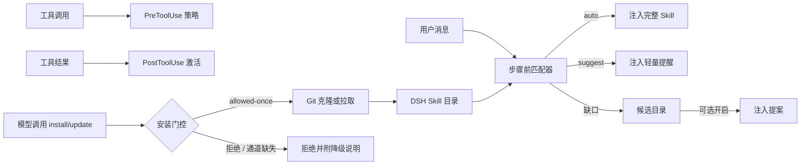

<div align="center">

<a id="dsh-skills-manager"></a>

# 🧩 dsh-skills-manager

**面向 DeepSeek Harness 的主动 Skill 激活、Hook 编排与 GitHub 同步插件。**

<a href="./README.md">English</a> · <strong>简体中文</strong>

[](https://www.npmjs.com/package/@existence001100/dsh-skills-manager)
[](https://github.com/Existence001100/dsh-skills-manager/actions/workflows/ci.yml)
[](./LICENSE)
[](https://nodejs.org/)
[](https://github.com/Existence001100/dsh-skills-manager/commits/main)
[](https://github.com/Existence001100/dsh-skills-manager/stargazers)

</div>

**🚀 快速安装**

```sh
dsh plugin --profile web add @existence001100/dsh-skills-manager
```

安装后请重启 Web profile。安装前请查看[环境要求与安装选项](#快速开始)。

> **1.1.1 变更：** 模型发起的 `skill_manager install` 或 `skill_manager update` 现在需要一次审批决定。要恢复 1.0.x 行为，请运行 `skill_manager set-config config={"installGate":"off"}`。详见[安装确认门控](#安装确认门控)。

[🚀 安装](#快速开始) · [✨ 功能](#核心特性) · [⚙️ 配置](#skill-配置) · [🐛 反馈](https://github.com/Existence001100/dsh-skills-manager/issues)

## 目录

- [为什么需要这个插件](#为什么需要这个插件)
- [核心特性](#核心特性)
- [工作原理](#工作原理)
- [快速开始](#快速开始)
- [兼容性](#兼容性)
- [Skill 配置](#skill-配置)
- [Hook 兼容性](#hook-兼容性)
- [GitHub 托管的 Skills](#github-托管的-skills)
- [安装确认门控](#安装确认门控)
- [候选目录](#候选目录)
- [项目级 Skills](#项目级-skills)
- [管理与可观测性](#管理与可观测性)
- [权限与数据](#权限与数据)
- [安全](#安全)
- [明确不做的决策](#明确不做的决策)
- [开发](#开发)

## 为什么需要这个插件

DSH 内置的 `skill` 工具依赖模型先注意到一段简短摘要，再自行决定是否加载完整 Skill。实际使用中，模型经常错过有价值的 Skill；Skill 文件无法直接声明生命周期行为；散落在本地的 Skill 也很难持续同步。

`dsh-skills-manager` 补齐了这些能力：

- 每轮请求都主动匹配可用 Skill；
- 强匹配自动加载，弱匹配轻量提醒；
- 将 Claude Code 风格的 Hook 声明映射到 DSH 宿主事件；
- 从 GitHub 安装、更新和卸载 Skill；
- 隔离用户级与项目级覆盖配置；
- 同时提供 Settings 界面和 `skill_manager` 模型工具。

## 核心特性

| 图标 | 功能 | 说明 |
| --- | --- | --- |
| 🚀 | 主动激活 | 强匹配注入完整 Skill，建议匹配只注入轻量提醒 |
| 🪝 | Skill 级 Hook | 支持 `UserPromptSubmit`、`PreToolUse`、`PostToolUse`、`PostToolUseFailure` 和 `SessionStart` |
| 🔄 | GitHub 生命周期 | 安装、更新、权威同步、卸载和 commit 变更报告 |
| 🧭 | Workspace 作用域 | 项目 Skill 可覆盖用户 Skill，同时避免配置跨 workspace 泄漏 |
| 🛠️ | 内置管理 | Settings 管理界面与 `skill_manager` 模型工具 |
| 🛂 | 安装确认门控 | 模型发起的 `install` / `update` 先请求一次审批；无审批通道时 fail-closed |
| 🧩 | 能力缺口提案 | 可选候选目录提出缺失技能建议；每轮最多一条，绝不自动安装 |
| 🛡️ | 安全护栏 | 来源白名单、Git 参数数组、Hook 路径校验，Hook 不经过 shell |

## 工作原理



每个 Agent 步骤开始前，插件都会为可用 Skill 打分：

1. 明确提及 Skill 名称：**+12**；
2. 命中触发词或正则表达式：**+7**；
3. 描述或 `whenToUse` 词元重合：**+4 到 +6**。

默认每轮最多自动加载 2 个 Skill、建议 3 个。激活标记会写入会话历史；只要标记仍在可见上下文中，就不会重复注入完整内容。上下文压缩移除标记后，Skill 可以再次自动加载。

两条独立约束保证模型不会自作主张：

- **安装确认门控。** 模型发起的 `skill_manager install` 与 `skill_manager update` 在执行任何 Git 命令之前，都会先向宿主审批接缝请求一次决定。只有 `allowed-once` 才继续；拒绝、取消、通道缺失或请求抛错一律 deny。模型会收到降级说明和结构化 code（见[安装确认门控](#安装确认门控)）。
- **能力缺口提案。** 当可选的候选目录列出了尚未安装的来源时，匹配器可以在该轮首个 step 注入一条提案。提案属于模型上下文，不是 UI 卡片，也绝不会自动安装——模型仍需调用 `install`，而该调用会被上面的门控拦截。该分支默认关闭；目录缺失、分数不足、或声明的技能都已安装时保持静默（见[候选目录](#候选目录)）。

## 快速开始

### 环境要求

- DeepSeek Harness `0.1.1-rc.2`、`0.1.2-alpha.3`、`0.1.3-alpha.1` 或 `0.2.0-rc.2`；
- Node.js `^22.19.0 || >=24.0.0`；
- `PATH` 中存在 pnpm，供 `dsh plugin` 调用。

### 从 npm 安装（推荐）

```sh
dsh plugin --profile web add @existence001100/dsh-skills-manager
```

DSH 会识别包内的 `dsh.bundle` manifest，并自动把 `@existence001100/dsh-skills-manager` 加入 Web Profile。安装完成后，请重启正在运行的 Web Profile。

### 从 GitHub 安装

```sh
dsh plugin --profile web add github:Existence001100/dsh-skills-manager
```

需要测试 `main` 中尚未发布的变更时，可以使用 GitHub 来源；如需可复现安装，请固定到具体 commit。

### 更新或卸载

```sh
dsh plugin --profile web update @existence001100/dsh-skills-manager
dsh plugin --profile web remove @existence001100/dsh-skills-manager
```

执行任一操作后请重启 Profile，确保运行时 composition 与已安装 Bundle 一致。

### 安装本地 Checkout 进行开发

```sh
git clone https://github.com/Existence001100/dsh-skills-manager.git
cd dsh-skills-manager
pnpm install --frozen-lockfile
dsh plugin --profile web add .
```

插件自带的 `cordis.patch.yml` 会把 `skill-manager` 插入宿主 composition，对所有会话生效。

## 兼容性

| 组件 | 支持或持续验证范围 |
| --- | --- |
| DeepSeek Harness | `0.1.1-rc.2` 依赖合同；`0.1.2-alpha.3` 依赖合同及隔离安装与 UI 烟测；`0.1.3-alpha.1` 发布标签源码接口核对及会话 Hook 回归测试；`0.2.0-rc.2` 隔离安装、Web 启动、Settings API 和真实 `/name` Skill 调用 |
| Node.js | `22.19.0` 与 `24.19.0` |
| pnpm | `11.19.0`，使用 frozen lockfile |
| 操作系统 | Ubuntu 与 Windows CI 矩阵 |

`0.1.3-alpha.1` 适配支持 `session.snapshotEvents()` 和数组形式的可见消息序号，同时保留旧版 events API。该版本的完整安装/UI 烟测仍待对应宿主包在 npm 可用后验证。

使用 DSH `0.2.0-rc.2` 时，请安装本插件 `1.0.6` 或更新版本：旧版插件发出的 `source.kind: "plugin"` 会被 DSH v4 会话格式拒绝。真实 Web Profile 测试中，`/ponytail-help` 成功注入完整 Skill 内容（`skill-invocation`），管理器消息使用 `plugin:dsh-skills-manager`，整轮对话正常完成。这验证了显式 Skill 调用和管理器注入；其他 `0.2.x` 宿主版本不在当前 peer 依赖范围内。

DSH 仍处于 developer preview。需要可复现安装时，请把插件固定到具体 commit；升级 DSH 依赖后应重新运行安装烟测。

## Skill 配置

在 SKILL.md 的 frontmatter 中直接声明激活条件与 Hook：

```yaml
---
name: repo-hardening
description: Review and harden a repository with build/test gates.
metadata:
  activation: auto             # auto | suggest | off
  triggers:
    - "harden"
    - "build fails"
    - "re:exit code \\d+"
  hooks:
    UserPromptSubmit:
      inject: "得出结论前必须先运行 build 与 test。"
    PreToolUse:
      - tool: bash
        when: "git push"       # 子串或 re:<pattern>
        decision: deny         # allow | deny | ask
        reason: "不允许直接 push"
    PostToolUse:
      - tool: bash
        when: "re:exit code [1-9]"
        action: activate
    SessionStart:
      activate: true
---
```

### 激活模式

| 模式 | 行为 |
| --- | --- |
| `auto` | 命中后立即注入完整 Skill |
| `suggest` | 命中后添加轻量提醒，由模型决定是否加载 |
| `off` | 不参与自动匹配，但模型仍可手动调用 |

Codex 风格的 `manual` 与 `disabled` 会作为 `off` 的别名处理。如果没有声明 `activation`，带显式 triggers 的 Skill 默认为 `auto`，其他 Skill 默认为 `suggest`。

对于允许用户调用的 Skill，DSH 还支持输入 `/name` 直接加载完整内容，不受管理器是否建议该 Skill 的影响；单独的 `suggest` 只会添加提醒。

### 触发词与策略

- 普通触发词执行大小写不敏感的子串匹配。
- `re:` 前缀表示正则表达式；无效正则会被忽略。
- `PreToolUse.tool` 可以填写具体工具名或 `*`。
- 工具策略返回 `allow`、`deny` 或 `ask`，并可附带原因。
- 用户覆盖配置可以存储在上游 SKILL.md 之外，避免更新时丢失本地策略。

覆盖配置示例：

```text
skill_manager set-triggers ponytail-review triggers=["review this diff","过度设计"]
skill_manager set-hooks repo-hardening hooks={"PostToolUse":[{"tool":"bash","when":"re:exit code [1-9]","action":"activate"}]}
```

## Hook 兼容性

| Skill Hook | DSH 宿主事件 | 支持情况 |
| --- | --- | --- |
| `UserPromptSubmit` | `agent/pre-step` | ✅ 激活期间每轮注入声明文本 |
| `PreToolUse` | `tools/pre-execute` | ✅ 根据工具名与参数执行 allow、deny 或 ask |
| `PostToolUse` | `tools/post-execute` | ✅ 工具输出命中后激活 Skill |
| `PostToolUseFailure` | `tools/post-execute` | ✅ 通过同一结果事件匹配失败文本 |
| `SessionStart` | `agent/session-start` | ✅ 无需匹配即可在会话开始时激活 |
| `SessionEnd` / `Stop` | `agent/disposed` / `agent/turn-stopping` | ⚠️ 仅可观察，不注入内容 |
| `PreCompact` | DSH 核心无对应事件 | ⚠️ 未实现；压缩移除激活标记后可重新注入 |

## GitHub 托管的 Skills

管理器接受 `owner/repo` 简写，以及完整的 `https://`、`git@` 或 `ssh://` Git URL。

```text
skill_manager install owner/repo
skill_manager update
skill_manager status
skill_manager uninstall skill-name
```

安装过程中，插件会：

1. 将单一分支浅克隆到 `<DSH_HOME>/skill-sources/<slug>`；
2. 在最多 3 层目录中发现包含 SKILL.md 的目录；
3. 跳过 `.git`、`node_modules`、`dist` 和 `build`；
4. 把发现的 Skill 复制到 `<DSH_HOME>/skills/<name>`。

更新时会拉取配置的 ref，把来源重置到 `FETCH_HEAD`，再对已安装 Skill 执行权威同步。随后文件监视器自动使目录缓存失效并派发 `skills/change`。

插件 Manifest 按以下顺序检测：

1. `.codex-plugin/plugin.json`；
2. `.claude-plugin/plugin.json`。

Settings 页面会展示插件名称、版本、Skills 和 Hook 数量。Manifest 中指向仓库内部 Node 脚本的安全生命周期 Hook，可用于 `SessionStart` 与 `UserPromptSubmit`。

状态保存在 `<DSH_HOME>/skill-manager.json`，包括来源、ref、commit、安装路径、作用域覆盖和最近 50 条操作记录。

## 安装确认门控

模型不能自行安装或更新 Git 来源。每一次模型发起的 `skill_manager install` 与 `skill_manager update` 调用，都会先请求一次决定。

| `installGate` | 行为 |
| --- | --- |
| `ask`（默认） | 弹出一张审批卡，用户允许这一次后才执行。 |
| `deny` | 不弹卡，直接拒绝。模型会收到原因，并可指引用户去 Settings。 |
| `off` | 恢复 1.0.x 行为，不再询问。 |

卡片会写出 Git 来源，并说明安装会复制整个仓库。卡片同时说明：安装前 Hook 仍处于未验证状态，因为此时还没有克隆仓库。

门控是 fail-closed。审批通道不可用、请求抛错、用户拒绝或取消时，不会执行任何 Git 命令。模型会收到一段降级说明和一个结构化 code：

| `code` | 原因 |
| --- | --- |
| `user-rejected` | 用户拒绝了这张卡。 |
| `approval-cancelled` | 用户取消，或所在 turn 被中止。 |
| `approval-unavailable` | 当前部署没有挂载审批应答器。 |
| `approval-error` | 审批请求抛错。 |
| `policy-deny` | `installGate` 为 `deny`。 |
| `invalid-source` | URL 缺失或不受支持。文案与安装报错逐字一致。 |
| `no-agent` | 这次调用没有 agent，无法询问用户。 |

通过模型工具配置门控：

```text
skill_manager set-config config={"installGate":"off"}
```

门控是插件策略，不是 Skill Hook。Skill 无法关闭它。

用户在 Settings → **Skill 管理** 中自己发起的安装不会被询问。用户发起动作，本身已经作出决定。

## 候选目录

只有当候选目录列出可安装来源时，插件才能提出能力缺口。该目录默认关闭，需要手动开启。

```json
{
  "version": 1,
  "entries": [
    {
      "repo": "owner/repo",
      "description": "这个技能仓库覆盖什么",
      "triggers": ["review", "re:exit code [1-9]"],
      "skills": ["review-helper"],
      "hooks": { "PreToolUse": true },
      "verified": false
    }
  ]
}
```

| 字段 | 含义 |
| --- | --- |
| `repo` | 必填。必须通过与 `install` 相同的来源白名单。 |
| `description` | 必填。用于匹配的文本，上限 300 字符。 |
| `triggers` | 可选。语法同 `metadata.triggers`，上限 32 条。 |
| `skills` | 可选。声明的技能名，安装前未验证。 |
| `hooks` | 可选。声明的事件名，安装前未验证。 |
| `verified` | 可选。维护者已人工核对仓库。 |

- 路径来自 `candidateCatalogPath`，默认 `<DSH_HOME>/skill-manager-candidates.json`。
- 上限：200 条条目、描述 300 字符、每条 32 个触发词。
- 不在 Git 白名单内的 `repo` 整条丢弃。候选目录不能扩大可克隆范围。
- 候选目录只列来源，不是注册表：已安装技能元数据仍只来自 `ctx.skills`。
- 用 `skill_manager set-config config={"proposeEnabled":true}` 开启。
- 用 `proposeThreshold`（默认 7）与 `maxPropose`（默认 1，每轮最多一张）调节。
- 文件缺失、分数不足、或声明的技能都已安装时，分支保持静默。
- 加载失败时每个文件版本只警告一次，同一个坏文件不会重复刷日志。
- 提案属于模型上下文，可能不会出现在对话里，也没有 UI 追踪。

## 项目级 Skills

Filesystem Provider 按以下优先级解析 Skill 根目录：

| 优先级 | 根目录 | Source |
| --- | --- | --- |
| 1 | `<project>/.dsh/skills` | `project-dsh` |
| 2 | `<project>/.agents/skills` | `project-agents` |
| 3 | 宿主配置的目录 | `custom` |
| 4 | `<DSH_HOME>/skills` | `user-dsh` |
| 5 | `<agentsHome>/skills` | `user-agents` |
| 6 | 内置 Skills | `bundled` |

项目 Skill 使用同一套匹配流程，并凭优先级在同名冲突中胜出。模式、触发词与 Hook 覆盖按 `scope` 和 `cwd` 存储，避免设置跨项目或泄漏到用户级 Skill。

项目内 Skill 仍由项目自己的 Git 仓库管理。管理器的 `update` 只同步用户级来源；项目改动由文件监视器自动刷新。

## 管理与可观测性

### Settings 界面


*页面展示激活控制、来源信息和 Skill 管理操作。*

Settings → **Skill 管理** 提供：

- 跟随 DSH 当前显示语言切换的英文与简体中文界面；
- 主动激活总开关；
- 每轮自动加载数量限制；
- GitHub 安装与更新操作；
- 每个 Skill 的模式、触发词、Hook、来源与 commit 信息；
- 项目 workspace 选择；
- 卸载操作与最近历史。

### 模型工具

`skill_manager` 支持 `status`、`install`、`update`、`uninstall`、`set-mode`、`set-triggers`、`set-hooks` 与 `set-config`。项目记录使用 `scope: project`，并且必须提供 `cwd`。

### 事件

- `skill-manager/hook` — `{ event, skill, action, detail, at }`，记录 Hook 活动。
- `skill-manager/update` — 安装、更新或卸载后的同步结果。
- `skills/change` — Skill 目录变化后由 Filesystem Provider 派发。

## 权限与数据

| 范围 | 行为 |
| --- | --- |
| 文件读取 | 读取宿主选择的 DSH 用户级与项目级 Skill 根目录，以及已配置 Git 来源中的元数据 |
| 文件写入 | 来源保存在 `<DSH_HOME>/skill-sources`，管理器拥有的 Skill 保存在 `<DSH_HOME>/skills`，状态保存在 `<DSH_HOME>/skill-manager.json` |
| 网络 | 仅在用户请求安装或更新来源时调用本地 `git`；插件不实现遥测 |
| 进程 | 以参数数组运行 `git`，并可执行仓库内显式声明的 Node 生命周期 Hook，附带时间与输出限制 |
| 模型发起的安装 | 执行任何 Git 命令前先请求一次审批决定；没有审批通道时 fail-closed |
| 凭据 | 不保存 Git 凭据；身份验证仍由用户的 Git 配置和凭据助手负责 |
| 会话上下文 | 读取当前提示与 Skill 目录进行匹配，并向当前会话注入激活或建议消息 |

卸载管理器拥有的 Skill 时会删除其复制目录。没有托管 Git 来源的本地手写 Skill 不会被管理器删除。

## 安全

- Git 来源必须匹配受支持的 URL 白名单。
- Git 参数以数组传递，不拼接为 shell 命令。
- Skill Hook 不经过 shell 执行。
- Manifest Hook 路径必须解析到克隆仓库内部的 Node 脚本。
- 无效正则和不受支持的 Hook 声明会被忽略。

安装带有可执行 Hook 的插件，意味着信任该仓库的代码。安装第三方来源前请先进行审查。

受支持版本与私密漏洞报告方式见 [SECURITY.md](./SECURITY.md)。

## 明确不做的决策

| 决策 | 原因 |
| --- | --- |
| 不经询问直接安装 | 最终决定权留给用户。插件从不自行安装，因此也不提供静默安装模式。 |
| approve / modify / reject 三态卡片 | DSH 审批卡只支持 allow-once 与 reject。modify 没有可落地的接缝。 |
| 安装前探测仓库的 Hook | 探测需要克隆和网络时间。卡片如实说明限制，不做猜测。 |
| 对未应答卡片做超时自动拒绝 | 任何超时数值都是武断的。未应答本身已经是 fail-closed，因为用户回答前不会执行任何操作。 |
| 把技能元数据存进候选目录 | 候选目录只列可安装来源。已安装技能元数据仍只来自 `ctx.skills`。 |

## 开发

```sh
pnpm test
pnpm lint
```

| 文件 | 职责 |
| --- | --- |
| `lib.js` | 纯函数：匹配、打分、状态、Hook 与 Manifest 处理 |
| `index.js` | DSH 事件、工具、RPC、Git 操作与集成接线 |
| `client/client.js` | Settings 管理界面 |
| `test.mjs` | Node 测试套件 |
| `cordis.patch.yml` | 宿主 composition 补丁 |

欢迎在 [GitHub 仓库](https://github.com/Existence001100/dsh-skills-manager)提交 Issue 或 Pull Request。
开发环境、验证命令与 Pull Request 要求见 [CONTRIBUTING.md](./CONTRIBUTING.md)。

## License

本项目基于 [MIT License](./LICENSE) 发布。
